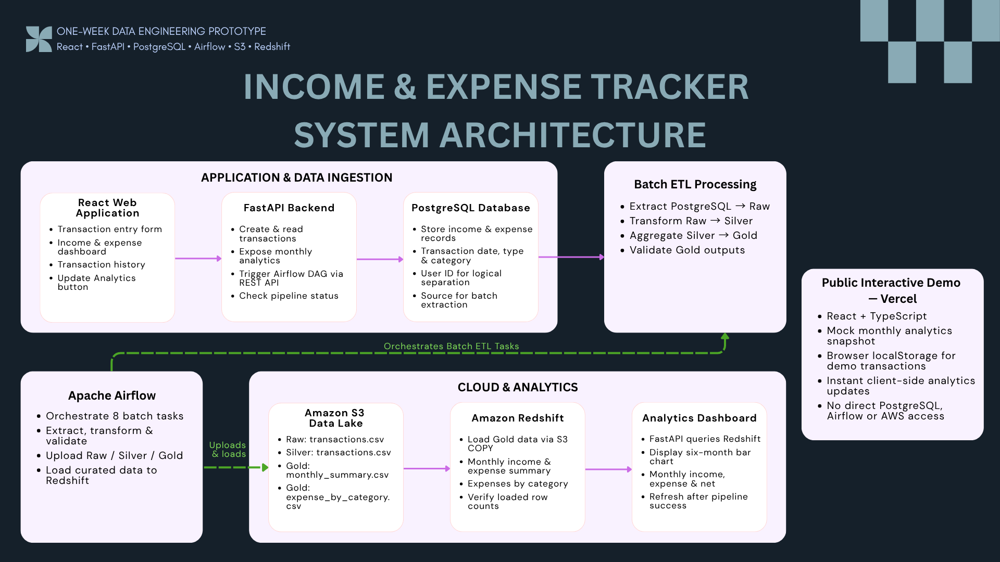
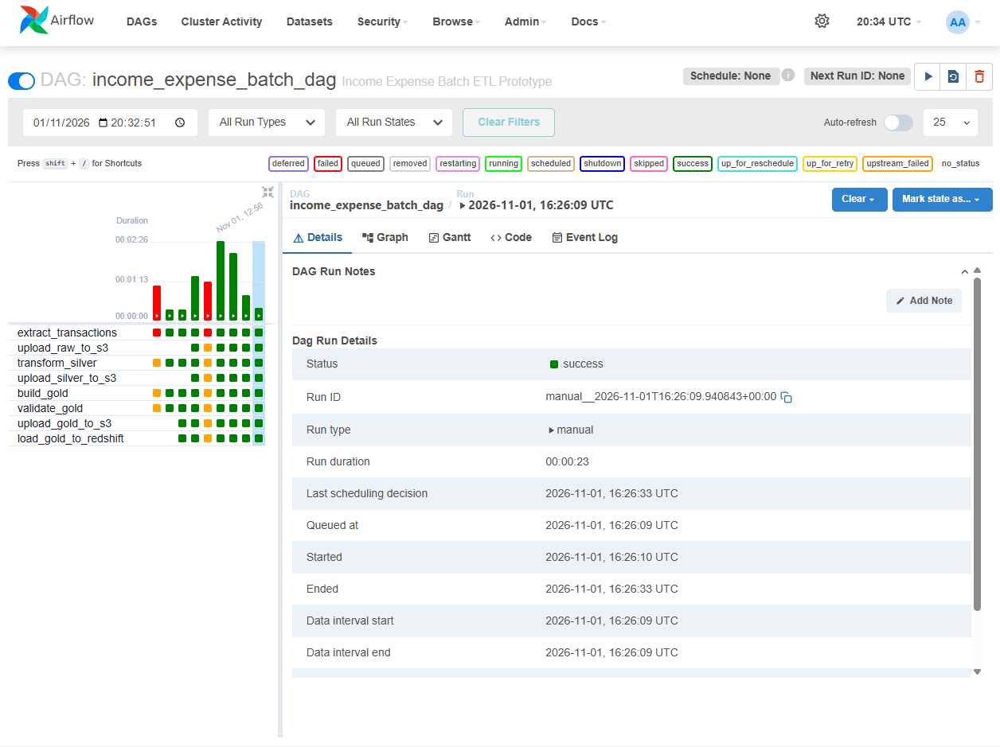
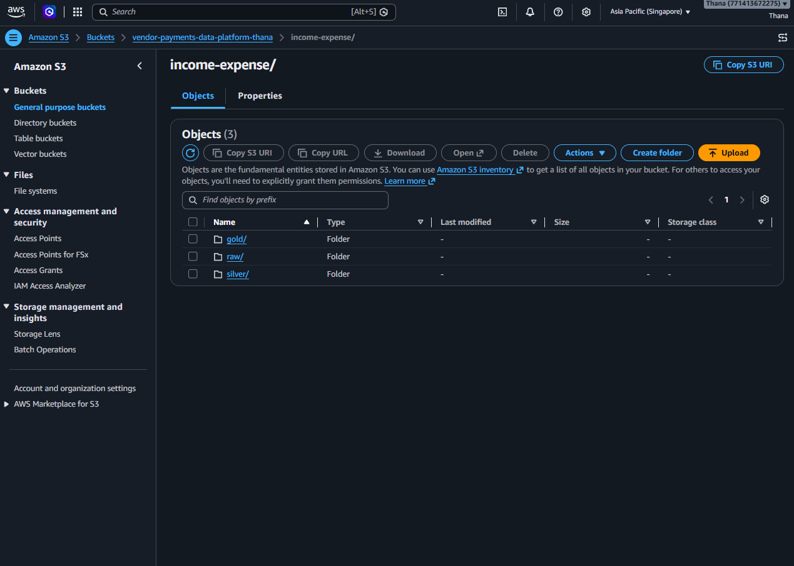
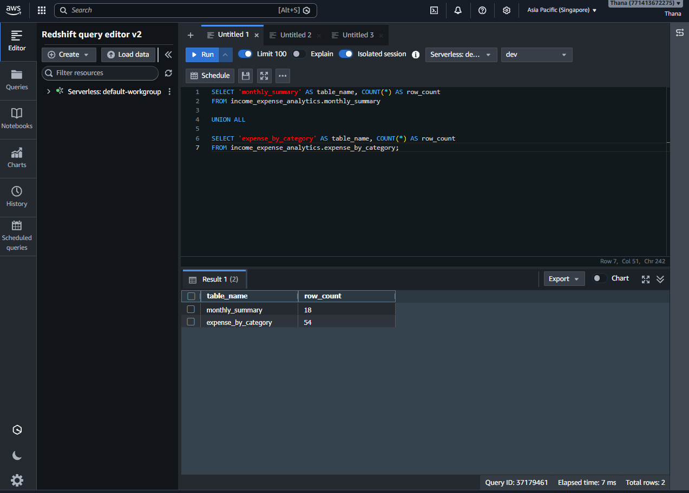
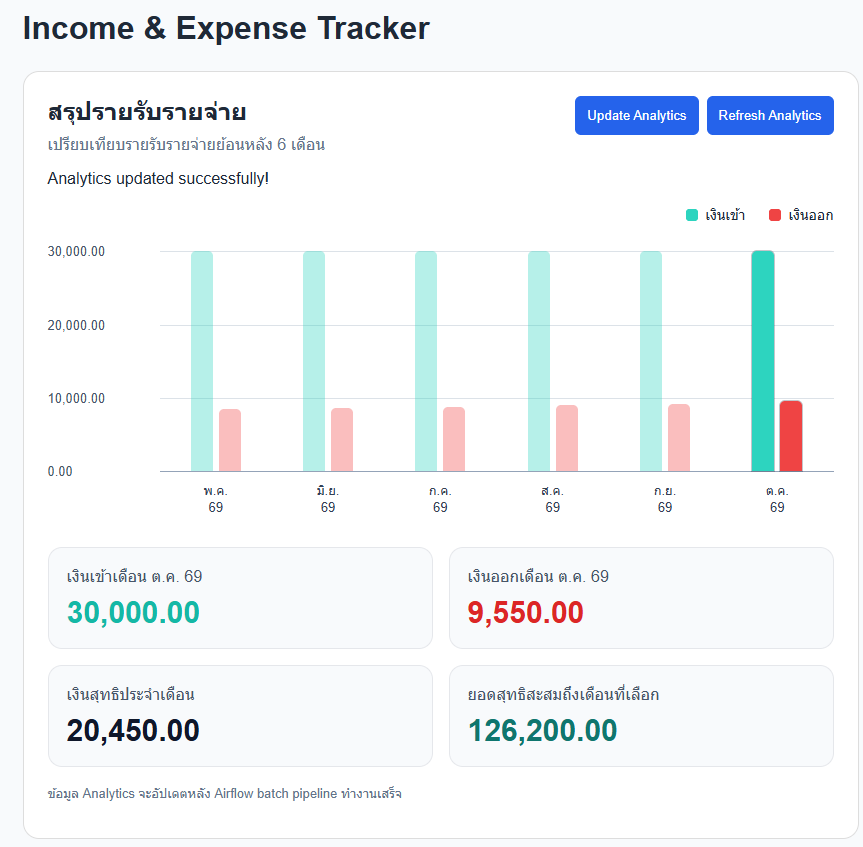
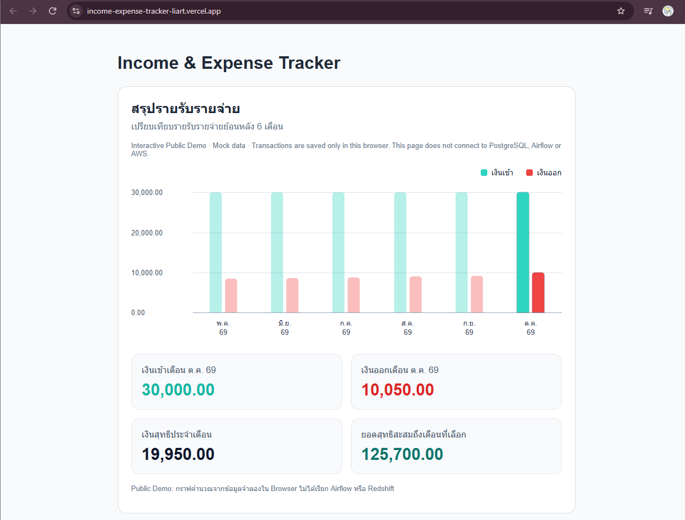

# Income & Expense Tracker


A **one-week data engineering prototype** that connects transaction entry, PostgreSQL storage, an Apache Airflow batch pipeline, Raw/Silver/Gold datasets on Amazon S3, curated analytics in Amazon Redshift, and a React dashboard.

The **full end-to-end pipeline runs locally** and was tested with a new expense transaction. A **separate interactive public demo** is hosted on Vercel using a mock analytics snapshot and browser-local transactions; it **does not call the live backend, Airflow, PostgreSQL, or AWS**.

**[Try the Interactive Demo](https://income-expense-tracker-liart.vercel.app/)** · **[Source Code](https://github.com/Chu-Thana/income-expense-tracker)** · **[System Architecture](docs/architecture/01-system-architecture.png)**

---

## Project at a Glance

| Metric / capability | Verified result |
|---|---|
| Local batch orchestration | **8 Airflow tasks** completed successfully |
| Data lake layers | **Raw, Silver, Gold** in Amazon S3 |
| Curated Gold datasets | **2** (`monthly_summary`, `expense_by_category`) |
| Redshift row counts | **18** monthly-summary rows; **54** category-summary rows |
| Local end-to-end update | October expense **THB 9,450 → 9,550** after a THB 100 transaction and pipeline refresh |
| Public demo interaction | October expense **THB 9,550 → 10,050** after adding THB 500 in the browser |
| Public deployment | Vercel interactive mock-data demo |

*These are observed results from a small, seeded prototype—not performance or production-scale benchmarks.*

## System Architecture



### Two distinct execution modes

| | Local full pipeline | Public interactive demo |
|---|---|---|
| Transaction entry | React → FastAPI → PostgreSQL | React → browser-local state / `localStorage` |
| Analytics processing | Airflow-triggered batch ETL → S3 → Redshift | Client-side recalculation using a static JSON baseline |
| Dashboard refresh | After the Airflow DAG finishes successfully | Immediately after a demo transaction |
| Infrastructure | Local Docker services + existing AWS resources | Static Vercel deployment only |
| Intended audience | End-to-end engineering demonstration | Reviewer-friendly UI exploration |

The public demo is deliberately **not** represented as a production deployment of the local pipeline.

## End-to-End Local Data Flow

1. **Create a transaction:** React calls `POST /transactions`; FastAPI writes the record to PostgreSQL. Transaction history is read from `GET /transactions`.
2. **Request an analytics update:** The user clicks **Update Analytics**. React calls FastAPI, which authenticates to the **Airflow REST API** and triggers `income_expense_batch_dag`.
3. **Run batch ETL:** Airflow orchestrates extraction, transformation, aggregation, validation, and S3 publishing across eight tasks.
4. **Load curated data:** After Gold validation, the pipeline uploads Gold files to S3 and loads them into Amazon Redshift using `COPY`.
5. **Refresh the dashboard:** React checks the DAG run status through FastAPI. After `success`, it requests monthly analytics, which FastAPI reads from Redshift.

### Airflow Batch DAG — 8 Tasks

| Order | Task | Purpose |
|---|---|---|
| 1 | `extract_transactions` | Read PostgreSQL transactions and write Raw CSV |
| 2 | `upload_raw_to_s3` | Publish Raw CSV to S3 |
| 3 | `transform_silver` | Transform Raw into Silver CSV |
| 4 | `upload_silver_to_s3` | Publish Silver CSV to S3 |
| 5 | `build_gold` | Build monthly and category-level Gold summaries |
| 6 | `validate_gold` | Validate Gold outputs before publishing |
| 7 | `upload_gold_to_s3` | Publish validated Gold CSVs to S3 |
| 8 | `load_gold_to_redshift` | Load Gold data and verify destination row counts |

The DAG is **manually triggered** for this prototype; an automatic production schedule is outside its scope.

### Data Lake and Analytics Outputs

```text
s3://<configured-bucket>/income-expense/
├── raw/
│   └── transactions.csv
├── silver/
│   └── transactions.csv
└── gold/
    ├── monthly_summary.csv
    └── expense_by_category.csv
```

Gold outputs are loaded to Redshift schema `income_expense_analytics` in tables `monthly_summary` and `expense_by_category`.

## Evidence and Validation

**Airflow: successful batch execution (8 tasks)**



**Amazon S3: Raw / Silver / Gold structure**



**Amazon Redshift: Gold table counts (18 / 54)**



**Local analytics dashboard, after a successful pipeline update**



In the local test, adding a **THB 100** October expense and running the full pipeline changed monthly expense from **THB 9,450** to **THB 9,550**, while monthly net decreased from **THB 20,550** to **THB 20,450**. This is the end-to-end behavior demonstrated by the local application, DAG execution, and updated dashboard together.

Additional evidence: [Local Dashboard](docs/evidence/02-local-dashboard.png) · [Transaction Entry & History](docs/evidence/03-transaction-created.png)

### Public Interactive Demo — Browser Only

| Before demo transaction | After adding a THB 500 expense |
|---|---|
|  |  |

The public version uses `frontend/public/demo/monthly_summary.json` as its baseline and stores demo transactions in the current browser. **No data is sent to PostgreSQL or AWS**, and demo changes are not shared with other visitors.

## Technology Stack

| Layer | Technologies |
|---|---|
| Web | React, TypeScript, Vite |
| API | Python, FastAPI |
| Transaction database | PostgreSQL 16, Docker |
| Batch processing | Python, Pandas |
| Orchestration | Apache Airflow 2.10.5 |
| Data lake | Amazon S3 |
| Analytics warehouse | Amazon Redshift Serverless |
| Cloud integration | boto3 / Redshift Data API |
| Public presentation | Vercel (static interactive demo) |

## Repository Layout

```text
income-expense-tracker/
├── backend/app/              # FastAPI, database, Airflow and Redshift clients
├── dags/                     # Income & Expense Airflow DAG source
├── database/init/            # PostgreSQL initialization SQL
├── pipeline/etl/             # Extract, transform, build, validate, upload, load
├── frontend/                 # React application; local and public demo modes
│   ├── public/demo/          # Mock monthly analytics snapshot
│   └── src/
├── docs/
│   ├── architecture/        # System architecture diagram
│   └── evidence/            # Verified screenshots
├── docker-compose.yml
└── requirements.txt
```

## Running the Prototype

### Public demo (no backend or AWS access required)

Open **[the live demo](https://income-expense-tracker-liart.vercel.app/)**. Add an income or expense transaction, observe the chart and summary cards change immediately, and use **Reset Demo Data** to return to the initial snapshot.

To preview the public mode locally, set `VITE_DEMO_MODE=true` in `frontend/.env.production`, then run:

```powershell
cd frontend
npm install
npm run build
npm run preview
```

### Local full pipeline (environment-specific)

The full path requires running PostgreSQL, the existing Airflow environment, configured AWS S3/Redshift access, and FastAPI. The Airflow deployment is **reused from a separate local orchestration environment**, so this repository alone is **not a one-command reproducible deployment** of all services.

Once those services and environment variables are configured, run the API and frontend in separate terminals:

```powershell
# From repository root
cd backend
..\.venv\Scripts\python.exe -m uvicorn app.main:app --reload --host 127.0.0.1 --port 8000
```

```powershell
cd frontend
npm install
npm run dev
```

- Local React: `http://localhost:5173`
- FastAPI docs: `http://127.0.0.1:8000/docs`
- Airflow UI (existing local environment): `http://localhost:8080`

The local application supports **Create and Read** transactions; the **Update Analytics** button triggers a DAG run and refreshes the Redshift-backed dashboard only after the run succeeds.

> **Configuration and security:** Keep `.env` files, PostgreSQL credentials, Airflow credentials, and AWS secrets out of Git. Pipeline-trigger endpoints are intended for the local prototype only and must not be exposed publicly without appropriate authentication, authorization, network controls, and rate limiting.

## Engineering Decisions and Trade-offs

- **Reuse infrastructure:** Reused an existing Airflow setup and existing AWS resources to prioritize an executable end-to-end workflow within one week.
- **Batch over instant warehouse writes:** New transactions persist to PostgreSQL immediately, but warehouse analytics update only after an explicitly triggered and successful Airflow run.
- **Validation before Gold publishing:** A dedicated Gold validation task runs before S3 publishing and Redshift loading; the prototype also checks destination row counts.
- **Clear demo boundary:** Vercel hosts a safe, interactive mock-data experience, while the actual data platform remains local rather than exposing unauthenticated infrastructure.
- **Limited implementation scope:** No chunked processing, Recovery DB, custom rollback mechanism, or production-grade orchestration resilience was added to this prototype.

## Scope and Limitations

- A `user_id` field supports **logical grouping of transactions**, but the prototype does **not implement authentication or authorization** and is **not a secure multi-user product**.
- Transactions support **Create and Read**; Update/Delete operations are not implemented.
- The local batch pipeline is manually triggered; the dashboard is not a streaming or real-time warehouse dashboard.
- The Public Demo is browser-only and does not demonstrate live Airflow, database, or AWS access.
- The running-balance card sums the available monthly net amounts from a zero opening balance; it is **not** a verified bank-account balance.
- The implementation is a **time-boxed interview prototype**, not a hardened production deployment.

---

**Project goal:** demonstrate end-to-end data engineering decisions and a working transaction-to-analytics feedback loop under a one-week delivery constraint.
